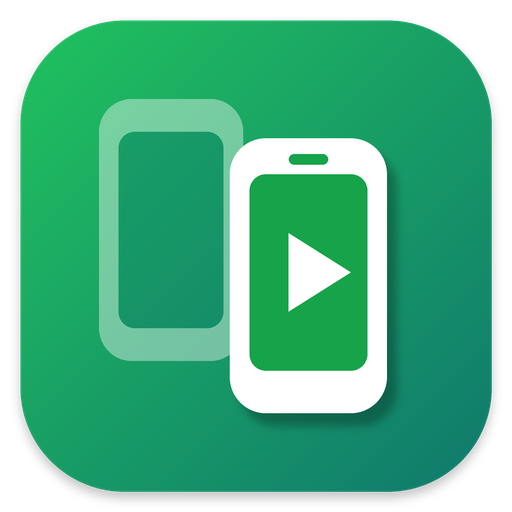

# Phone Share



**See and control another Android phone from your Android phone.** No computer and no account. Root isn't needed for everyday use.

Phone Share puts the other phone's screen on yours, full screen or in a small floating window like YouTube's popup player. You can tap, swipe and type on it, and hear its sound. It uses the [scrcpy](https://github.com/Genymobile/scrcpy) server (pinned to upstream `v5.0.1`) and talks to it directly over the network, so you don't need a desktop `adb`.

> **Status: Beta 2 (`v5.0.1-beta2`).** It works, but expect rough edges. Please report problems and attach the logs (see [Troubleshooting](#troubleshooting)).

---

## Contents

- [Download](#download)
- [Quick start](#quick-start)
- [Features](#features)
- [Sharing over the internet (Cloudflare)](#sharing-over-the-internet-cloudflare)
- [The phone being shared](#the-phone-being-shared)
- [Floating player](#floating-player)
- [Settings](#settings)
- [Performance](#performance)
- [Troubleshooting](#troubleshooting)
- [Privacy and security](#privacy-and-security)
- [Build from source](#build-from-source)
- [Releases](#releases)
- [Licensing](#licensing)

---

## Download

Get the newest release from the **[Releases page](https://github.com/lemonrsh/Phone-share/releases)**. Each release contains both editions. Install **one**:

| File | Edition | Size | Use it when |
|---|---|---|---|
| `phone-share-<version>-debug.apk` | **Standard** | ~2 MB | Both phones are on the same Wi-Fi or VPN (e.g. Tailscale) and you connect by IP address. |
| `phone-share-<version>-cloudflared-debug.apk` | **Cloudflare** | ~42 MB | You also want to share a phone **over the internet with a link**, or open such links. |

- **Which file:** install a **`-debug.apk`**. It's signed with the project's fixed key, so later versions install over it and keep your settings. The `-unsigned.apk` files are only for people who sign the app themselves.
- **Switching editions:** both editions have the same app ID (`com.lemonrsh.phoneshare`) and signing key, so installing one replaces the other.
- **Coming from an older version:** versions before 5.0.1-r20 used the ID `org.las2mile.scrcpy`. Uninstall that one; the new app installs separately.

Requirements: Android 5.0 or newer on both phones. Sound needs Android 11 or newer on the phone being shared.

---

## Quick start

**On the phone you want to see (the "shared" phone):**

1. Turn on **Developer options** and **USB debugging**.
2. Turn on **ADB over Wi-Fi on port 5555**. Without root, Android only allows this from a computer, once per reboot: `adb tcpip 5555`. With root, Phone Share does it in one tap (Settings › ADB on this device).
3. Optional: install Phone Share there too. It then shows a "connected" notification with a **Disconnect** button.

**On your phone (the controller):**

1. Open Phone Share and enter the other phone's IP address, e.g. `192.168.1.20` (add `:port` if it isn't 5555).
2. Tap **Connect**. The first time, tap **Allow** on the shared phone's "Allow USB debugging?" prompt.

**Over the internet instead:** with the Cloudflare edition, tap **Start sharing** on the shared phone and send the link. On the other phone, open the link and tap **Connect**. See [Sharing over the internet](#sharing-over-the-internet-cloudflare).

---

## Features

**Mirroring and control**
- Full-screen mirroring, or a **floating player** that keeps playing over other apps.
- **Auto floating window:** pressing Home or switching apps while connected moves the live session into the floating player without reconnecting.
- Touch, swipe, keyboard, and Back / Home / Recents buttons.
- **Two-way clipboard sync** (full screen).
- Sound from the shared phone (AAC, Opus, FLAC or raw). It can play **on both phones** at once.
- Rotation and app switching keep the session alive.

**Easy to use**
- The main screen shows just the connection status, **Connect** (it becomes **Disconnect** while connected), the address box and sharing. Everything else is under the **gear** (top right).
- **Recommended defaults:** 480p, 1 Mbps, 30 fps, H.264, sound on and playing on both phones. **↺ Use recommended settings** restores them at any time.
- Every setting is remembered.
- Green interface in light and dark mode.

**Questions at start-up**, one at a time:
1. **Allow the floating window?** Android's "Display over other apps" permission. Choose **Go to settings** or **Do it later**.
2. **Let Phone Share run in the background?** Removes battery restrictions with one system dialog, so the floating player, sharing and notifications keep working with the screen off. Choose **Allow** or **Do it later**.
3. **Turn on ADB on this phone?** Asked only when port 5555 is off. Choose **Enable ADB**, **Nah, I just want to control another phone**, or tick **Don't ask again**.

**Notifications**
- **"Phone Share is running"** with **Stop**, on the controller, during a session.
- **"<device> is connected to this phone"** with **Disconnect**, on the shared phone. See [The phone being shared](#the-phone-being-shared).

**Fast reconnects**
- The scrcpy server is only uploaded when the copy on the shared phone is different.
- If the shared phone has the same Phone Share version installed, the server is copied from that app instead of being uploaded. This is much faster over the internet.

---

## Sharing over the internet (Cloudflare)

*Cloudflare edition only.* Mirror a phone from anywhere. The phones don't need the same Wi-Fi, a VPN or a Cloudflare account.

1. **On the shared phone**, open Phone Share and tap **Start sharing**. After a few seconds you get a link like
   `https://blue-river-cat.trycloudflare.com/482913`
2. Tap **Send…** (shares **only the link**) or **Copy link**.
3. **On the other phone**, open the link:
   1. The link opens a small page that launches **Phone Share** with the address filled in.
   2. The app asks **"Connect to this phone?"**. Tap **Connect**.
   3. On the shared phone, tap **Allow** the first time.

**If it doesn't go that way:**
- **The browser blocks the jump to the app:** tap **Open in Phone Share** on the page.
- **Phone Share isn't installed:** the page offers the download.
- **Pasting also works:** paste the link into the address box and tap **Connect**.

**Good to know**
- **A new link every time** you start sharing. The 6-digit PIN at the end protects it.
- **Robust links:** links still work when a messenger adds tracking parts (like `?fbclid=…`), when the whole message is pasted instead of just the link, and in the old Beta 1 form (`…/#482913`).
- **Needs ADB on port 5555** on the shared phone. The app tells you if it's off.
- **Test service:** quick tunnels are Cloudflare's free testing service, with no uptime guarantee and more delay than the same Wi-Fi. Use 480p and 1 Mbps for the smoothest picture.

**How it works:** the shared phone runs a PIN-checked WebSocket bridge on `127.0.0.1` to its own ADB (5555) and scrcpy (7007) ports, and a bundled `cloudflared` publishes it. The controller opens each connection as a `wss://` WebSocket.

`cloudflared` is built by CI as a static binary (arm64-v8a, armeabi-v7a, x86_64) and bundled as `libcloudflared.so`; it isn't in the repository. Android has no `/etc/resolv.conf`, so the app passes the phone's DNS servers to it (`tools/cloudflared/android_dns.go`).

---

## The phone being shared

If Phone Share (r21 or newer) is also installed on the shared phone:

- **Notification:** while someone is connected, it shows a notification for the whole session, e.g. **"Pixel 8 is connected to this phone · It can see and control your screen"**.
  - It has a **Disconnect** button that ends the session immediately.
  - It goes away by itself when the session ends.
  - It works without root, even when the app is closed. On Android 13+, allow notifications; the app asks when you turn on ADB 5555 or start sharing.
- **In the app:** the main screen lists who is connected, with their IP and start time, and a **Disconnect** button.
- **Safe from fake alerts:** only the scrcpy server, which runs as the shell user, can trigger the notification. Other apps can't fake it, and the session info is only reachable from `127.0.0.1`.

**ADB on this device** (Settings) shows whether this phone accepts ADB over Wi-Fi and lists its addresses to connect to.
- **With root:** one tap turns it on (optionally kept after reboot) or off.
- **Without root:** it explains how to use `adb tcpip 5555` from a computer.

**Set up everything with root** (rooted phones only) does everything in one tap and one root prompt:
- turns on developer options, ADB and ADB over Wi-Fi on 5555 (kept after reboot);
- allows the floating window and notifications;
- removes battery restrictions;
- stops Android 11+ from forgetting allowed phones after 7 days.

The box always shows the **live status**: ✅ **Everything is set up** survives force stops and reboots. It never bypasses the "Allow USB debugging?" prompt.

---

## Floating player

Works like YouTube's popup player:

- **Look:** a rounded card that starts small in a corner and keeps the remote screen's shape.
- **Move:** drag it, using the small handle at the top when remote control is on, or two fingers. It snaps to the nearest side.
- **Resize:** pinch, or double-tap the handle to switch between small and large.
- **Close:** there's no close button. Drag it onto the ✕ at the bottom, fling it down, or throw it off a side.
- **Control:** one finger on the video controls the remote phone. Tap the handle for Back / Home / Recents.

---

## Settings

Open them with the **gear** (top right). The back arrow returns to the main screen.

- **ADB on this device:** see [above](#the-phone-being-shared).
- **Appearance and window:** dark mode, floating or full-screen, auto floating window.
- **Normal** (green, collapsed at first): video size, bitrate, frame rate, sound, sound on both phones, keep the remote screen awake, wake the screen, show touches, no control, and **↺ Use recommended settings**.
- **Advanced** (blue, collapsed at first): every other scrcpy v5.0.1 server option that makes sense on a phone.
  - **Video:** codec (H.264/H.265/AV1), encoder, codec options, downsize on error, size alignment.
  - **Audio:** codec, source (output, playback, microphone, voice call…), bitrate, encoder.
  - **Control:** clipboard sync, start an app on connect, screen-off timeout, time limit, cleanup.
  - **Display and capture:** display ID, orientation, angle, crop, or the **camera** (ID, facing, size, frame rate, zoom, torch).
  - **Virtual display:** size and dpi, system decorations, IME policy.
  - **Server log level.**

  Values are checked before anything is sent. Desktop-only options (recording, window flags, USB/OTG, HID) aren't included.
- **Logs:** see [Troubleshooting](#troubleshooting).

---

## Performance

Phone Share is tuned for the lowest delay rather than the sharpest picture:

- **Decoder:** hardware decoding straight to the screen, with Android's real-time and low-latency hints. It also uses chip-specific low-latency switches for Qualcomm, Samsung Exynos and HiSilicon decoders, and falls back automatically if a decoder rejects them. Frames are shown the moment they're decoded.
- **Thread priority:** the video, sound and touch threads run at Android's display and audio priorities, so background work doesn't delay them.
- **Network:** TCP_NODELAY on every connection, a 1 MB receive buffer for video, and key frames requested after a dropped frame.
- **Cloudflare link:** each WebSocket frame goes out in one write (one TLS record instead of two), and buffers are reused, so the phone isn't slowed by memory cleanup.
- **Recommended defaults:** 480p, 1 Mbps and 30 fps give the smoothest result, especially over mobile data or Cloudflare. Raise them only on fast Wi-Fi.

---

## Troubleshooting

Open **Settings › Logs** (no root needed):

- **Connection log:** every step of each attempt, plus everything the shared phone's shell and the scrcpy server printed.
- **App log:** this app's logcat and the last crash, if any.
- **Target:** **Fetch from target** reads diagnostics from the other phone over ADB: device, Android version, the server file, a server self-test and its logcat.

Each section has **Copy** and **Share**. When the floating player shows an error, tap it to open the log.

| Message | What to do |
|---|---|
| **ADB is not listening on …** | ADB over Wi-Fi is off on the shared phone. Run `adb tcpip 5555`, or use the root button there. |
| **The target hung up during ADB authorization** / **Timed out waiting for ADB authorization** | Unlock the shared phone and tap **Allow** on "Allow USB debugging?". No prompt? Use *Developer options › Revoke USB debugging authorizations* and try again. |
| **The scrcpy server stopped: …** | ADB worked but the server exited; the message includes its last output. Try 480p and H.264. |
| A share link says **missing its PIN** | Ask for the whole link, including the 6 digits at the end. |
| The "connected" notification doesn't show | Install Phone Share on the shared phone and allow notifications. Android 12+ may delay it until the app is opened once. |

Android 11+ **Wireless debugging** pairing codes aren't supported yet. Use classic ADB over TCP on port 5555.

---

## Privacy and security

- **No data collected:** no accounts, analytics or ads. Settings stay on the phone.
- **ADB authorization:** the shared phone must accept the controller's ADB key with **Allow**, and the app never bypasses this.
- **Local network:** the scrcpy server only accepts the media connection from the address that opened the ADB connection. The video stream isn't encrypted on the local network, so only use it on networks you trust, or over a VPN.
- **Over Cloudflare:** traffic is TLS-encrypted to Cloudflare. Each link has a new random address and a 6-digit PIN, and it stops working when sharing stops.
- **Stopping a session:** the shared phone always shows who is connected and can **Disconnect** at any time.

---

## Build from source

Requirements: JDK 17, Android SDK Platform 36, build-tools 36.0.0.

```sh
./gradlew assembleStandardDebug      # standard edition
./gradlew assembleCloudflaredDebug   # Cloudflare edition (needs app/src/cloudflared/jniLibs, built by CI)
./gradlew testStandardDebugUnitTest  # unit tests
```

- **Modules:** `:server` is the scrcpy v5.0.1 server (with a small session beacon). It's packaged as `scrcpy-server.jar` inside the app. `:app` is the viewer (`com.lemonrsh.phoneshare`).
- **Editions:** two product flavors, `standard` and `cloudflared`. `app/src/cloudflared/` adds the sharing service and the bundled binary.
- **Output:** APKs land in `app/build/outputs/apk/<edition>/<debug|release>/`. Debug builds are signed with `app/debug.keystore`. Release builds are unsigned, so never commit real signing keys.
- **Icon:** generated by `tools/icon/make_icon.py`.

---

## Releases

The **Android APK** GitHub Actions workflow builds and tests both editions on every pull request and push to `main`. To publish, run it manually with **Publish GitHub release** on and a tag (e.g. `v5.0.1-beta2`).

**One release** holds all four files, built from the same commit:
- `phone-share-<tag>-debug.apk` (Standard)
- `phone-share-<tag>-cloudflared-debug.apk` (Cloudflare)
- the two matching `-unsigned.apk` files

Releases up to r22 were published as two separate releases (`<tag>` and `<tag>-cloudflared`).

---

## Licensing

- The scrcpy server (`server/`) is Apache-2.0 licensed (© Genymobile); see `server/LICENSE`.
- The Android app and the rest of the project are GPL-3.0 licensed; see `LICENSE`.
- `cloudflared` (Cloudflare edition) is Apache-2.0 licensed (© Cloudflare). Phone Share isn't affiliated with Genymobile or Cloudflare.
